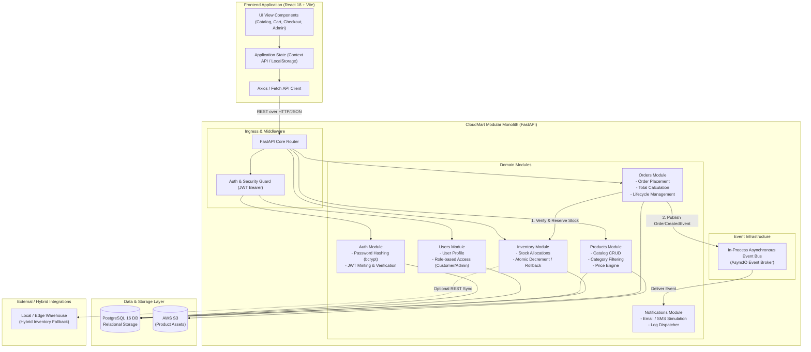
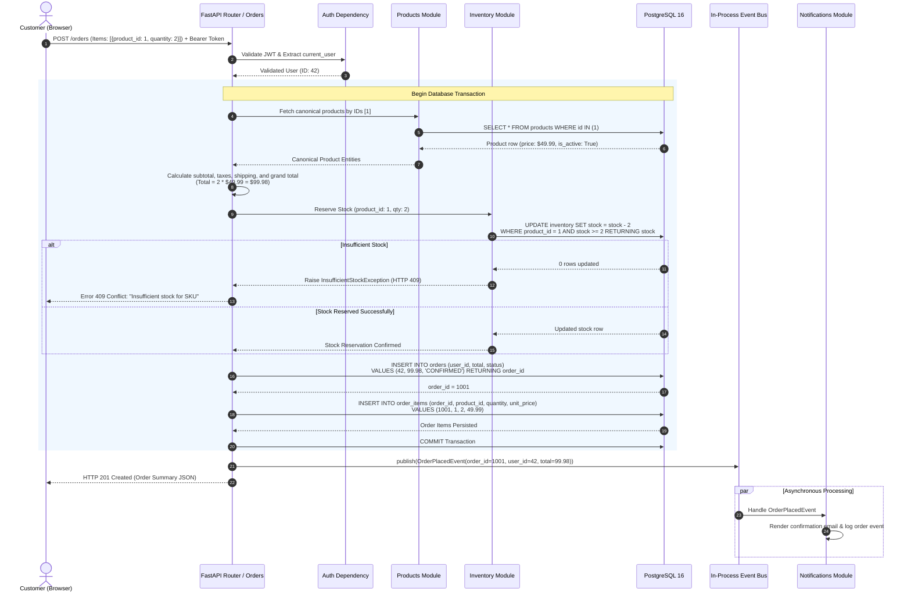
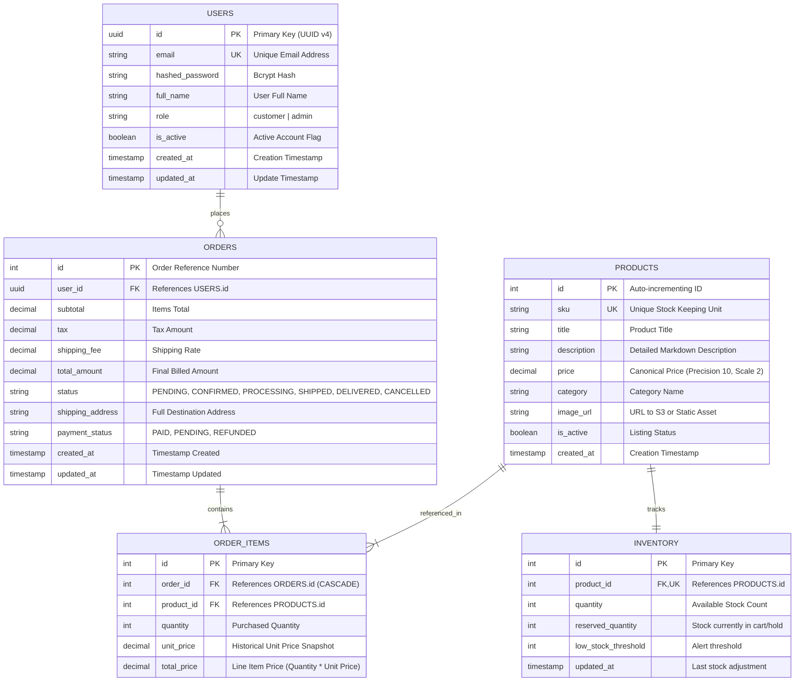

# CloudMart System Architecture

## 1. System Overview

CloudMart is designed as a **cloud-native modular monolith** implementing Domain-Driven Design (DDD) principles. In modern cloud application design, jumping immediately to microservices introduces significant operational overhead—network latency, distributed transaction complexities (Saga patterns), data inconsistency, and complicated CI/CD requirements. 

CloudMart deliberately embraces a modular monolithic architecture:
- All domain modules (`auth`, `users`, `products`, `inventory`, `orders`, `notifications`) reside in a single codebase and execute within a single runtime process (FastAPI / Uvicorn).
- Domain modules maintain strict boundary isolation: modules interact through well-defined internal service interfaces and an asynchronous, in-process event bus rather than direct tight coupling.
- Every domain encapsulates its own business rules, domain entities, and data access logic.
- When scaling requirements demand it, any individual module can be extracted into an independent microservice with minimal architectural refactoring.

```
+-----------------------------------------------------------------------------------+
|                                Client Layer (SPA)                                 |
|                         React 18 + Vite 5 + Browser Storage                       |
+-----------------------------------------------------------------------------------+
                                          |
                                    HTTPS / REST
                                          v
+-----------------------------------------------------------------------------------+
|                             API Gateway / Reverse Proxy                           |
|                       Nginx / Ingress Controller / Uvicorn                        |
+-----------------------------------------------------------------------------------+
                                          |
                                          v
+-----------------------------------------------------------------------------------+
|                        CloudMart FastAPI Application Core                         |
|                                                                                   |
|  [ Middleware: CORS | Request Logging | JWT Security Dependency Injection ]       |
|                                                                                   |
|  +----------------+  +-----------------+  +-----------------+  +---------------+  |
|  |  auth Module   |  |  users Module   |  | products Module |  | orders Module |  |
|  +----------------+  +-----------------+  +-----------------+  +---------------+  |
|                                                    |                   |          |
|                                           +-----------------+          v          |
|                                           |inventory Module |<-- [Check/Reserve]  |
|                                           +-----------------+          |          |
|                                                                        v          |
|                                           +------------------------------------+  |
|                                           |     In-Process Async Event Bus     |  |
|                                           +------------------------------------+  |
|                                                              |                    |
|                                                              v                    |
|                                                    +--------------------+         |
|                                                    |notifications Module|         |
|                                                    +--------------------+         |
+-----------------------------------------------------------------------------------+
                                          |
                               SQLAlchemy 2.0 (Async)
                                          v
+-----------------------------------------------------------------------------------+
|                                Persistence Layer                                  |
|                                  PostgreSQL 16                                    |
+-----------------------------------------------------------------------------------+
```

---

## 2. Component Diagram

The following Mermaid component diagram illustrates the structure of the system, including external integrations and internal module interactions.



---

## 3. Module Responsibilities

Each module inside `backend/app/modules/` adheres to separation of concerns:

### 3.1 Auth Module (`app.modules.auth`)
- **Responsibilities**:
  - User registration authentication handler.
  - Credential verification using `passlib` with `bcrypt`.
  - Creation and signing of JSON Web Tokens (`python-jose`) with HMAC-SHA256.
  - Token decoding, signature verification, and expiration validation.
  - Providing reusable FastAPI dependencies: `get_current_user` and `get_current_admin`.

### 3.2 Users Module (`app.modules.users`)
- **Responsibilities**:
  - Managing user records: customer details, email uniqueness, hashed passwords, and roles (`customer`, `admin`).
  - Profile retrieval and update endpoints (`/auth/me`).
  - Role-Based Access Control (RBAC) enforcement across administrative routes.

### 3.3 Products Module (`app.modules.products`)
- **Responsibilities**:
  - Maintenance of the product catalog (title, description, price, category, SKU, image URL).
  - Public querying with pagination, category filters, and keyword searches.
  - Administrative catalog management (product creation, updates, and soft/hard deletion).
  - Providing canonical product price data to other internal modules.

### 3.4 Inventory Module (`app.modules.inventory`)
- **Responsibilities**:
  - Real-time stock level tracking linked to product IDs.
  - Atomic stock checks and conditional reservations during order creation.
  - Restocking / rollback logic when orders are cancelled or payments fail.
  - Hybrid-cloud fallback hooks to sync with edge or localized warehouse systems.

### 3.5 Orders Module (`app.modules.orders`)
- **Responsibilities**:
  - Orchestrating the order creation lifecycle.
  - **Server-Side Price Calculation**: Discarding client-submitted prices and calculating order totals exclusively from trusted database product records.
  - Persisting orders and individual order line items within an atomic database transaction.
  - Transitioning order status through the lifecycle: `PENDING` &rarr; `CONFIRMED` &rarr; `PROCESSING` &rarr; `SHIPPED` &rarr; `DELIVERED` (or `CANCELLED`).
  - Emitting domain events (`OrderPlacedEvent`, `OrderStatusChangedEvent`) to the internal event bus.

### 3.6 Notifications Module (`app.modules.notifications`)
- **Responsibilities**:
  - Subscribing to domain events emitted on the in-process event bus.
  - Generating and dispatching order confirmation notices (mocking email/SMS delivery).
  - Logging fulfillment alerts for operations and audit logging without blocking the HTTP request thread.

---

## 4. Data Flow: Order Placement Workflow

Order placement is the core business process in CloudMart. The sequence below demonstrates atomic transactional safety, server-side price computation, inventory reservation, and asynchronous event emission.



---

## 5. Event and Notification Flow

CloudMart utilizes an asynchronous, non-blocking in-process event bus built on Python's `asyncio.Queue` and publish/subscribe handlers.

```mermaid
flowchart LR
    subgraph Publisher["Publishing Domain"]
        OrderModule["Orders Module"]
    end

    subgraph EventBroker["Internal Async Event Bus"]
        Bus["EventDispatcher<br/>(AsyncIO Tasks)"]
    end

    subgraph Subscribers["Event Consumers (Subscribers)"]
        EmailWorker["Email Dispatcher<br/>(Order Confirmation)"]
        AuditLogger["Security & Audit Logger<br/>(Structured JSON Logs)"]
        MetricsCollector["Prometheus / CloudWatch<br/>Metrics Exporter"]
    end

    OrderModule -->|publish(OrderPlacedEvent)| Bus
    Bus -->|dispatch| EmailWorker
    Bus -->|dispatch| AuditLogger
    Bus -->|dispatch| MetricsCollector
```

### Event Handling Characteristics:
1. **Fire-and-Forget Decoupling**: The HTTP response is delivered to the customer immediately after the database commit. Notification dispatching happens in the background.
2. **Error Isolation**: If the notification service encounters an external email delivery failure, the transaction is **not** rolled back, protecting the customer's completed purchase.
3. **Microservices Migration Path**: Replacing the in-process `asyncio.Queue` with RabbitMQ, Apache Kafka, or AWS SQS requires zero modifications to the calling domain modules; only the transport adapter in `app.core.events` is modified.

---

## 6. Database Schema Overview

CloudMart uses PostgreSQL 16 managed via SQLAlchemy 2.0 declarative models and Alembic migrations.



### Schema Invariants:
- **Historical Immutability in Order Items**: `order_items` stores a copy of the canonical product `unit_price` at the moment of checkout. If product prices change later in the `products` table, historical order invoices remain 100% accurate.
- **Relational Integrity**: Foreign key constraints enforce referential integrity. Orders cannot be orphaned if users are deleted.
- **Atomic Concurrency**: Inventory updates use conditional writes (`WHERE stock >= requested_quantity`) to prevent overselling under high concurrency.

---

## 7. Decision Rationale: Modular Monolith

When architecting CloudMart, the team evaluated two primary options: **Microservices from Day 1** versus a **Modular Monolith**.

| Architectural Metric | Microservices | Modular Monolith (Chosen) |
| :--- | :--- | :--- |
| **Operational Complexity** | High (Service mesh, distributed tracing, multi-repo CI/CD) | Low (Single deployment unit, unified runtime) |
| **Data Consistency** | Eventual consistency, complex two-phase commits or Sagas | Strict ACID compliance via standard PostgreSQL transactions |
| **Development Velocity** | Slower initial pace, complex local mock environments | Rapid iteration, fast local builds, simple debugging |
| **Testing** | Difficult contract testing, heavy end-to-end integration tests | Fast in-memory unit tests (SQLite), predictable integration testing |
| **Cost Efficiency** | High (Requires multiple container instances, Kubernetes overhead) | Low (Runs on single modest instance or container) |
| **Refactoring Safety** | High friction (API versioning, breaking cross-network contracts) | Low friction (Strongly-typed internal Python interfaces) |

### Migration Strategy to Microservices
If traffic scales exponentially, CloudMart is architecturally pre-factored:
1. Module boundaries are strictly enforced through directory structure and interfaces.
2. Direct cross-database joins across domains are avoided.
3. An event bus already decouples order handling from downstream notifications and inventory side effects.
4. Each module can be moved into its own Docker container and repository without refactoring domain logic.
