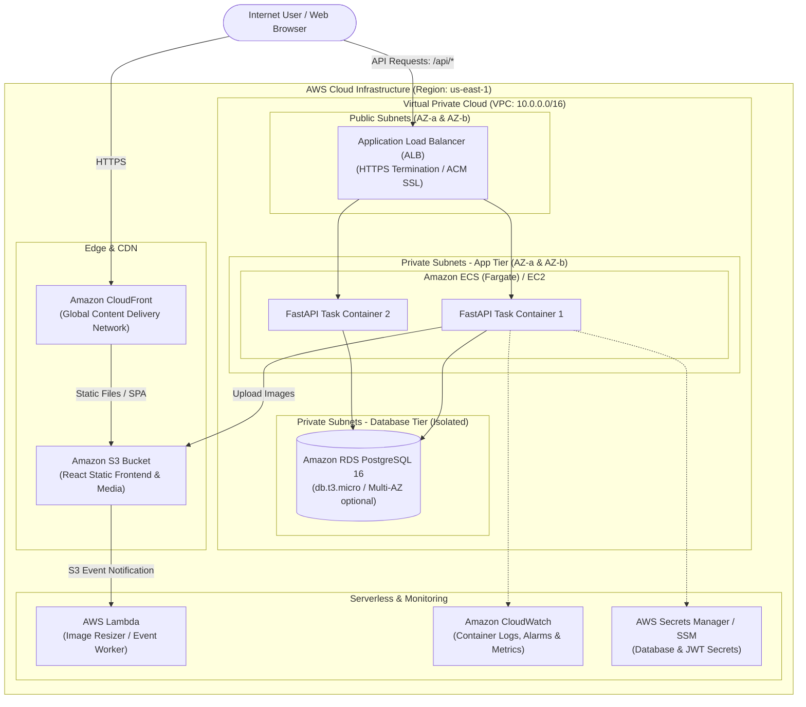

# CloudMart AWS Cloud Deployment Guide (Target Architecture)

> [!IMPORTANT]
> **FUTURE ARCHITECTURE NOTICE**
> 
> This document specifies the target architecture and operational runbook for deploying CloudMart onto Amazon Web Services (AWS). **The application is NOT currently deployed to AWS.** CloudMart runs locally via Docker Compose and Minikube. 
> 
> Deploying to AWS incurs real financial costs. Review all sections on cost verification, Free Tier eligibility, and the Mandatory Cleanup Checklist before creating any AWS infrastructure.

---

## 1. Cost Warnings & Free Tier Verification

### Cost Warning: Why Amazon EKS is NOT Recommended for This Project
> [!WARNING]
> **DO NOT USE AMAZON EKS (Elastic Kubernetes Service) FOR THIS PROJECT**
> 
> A single Amazon EKS control plane incurs a fixed cost of **$0.10 per hour ($73.00/month)** purely for cluster management, regardless of whether any workloads or worker nodes are running. Adding minimum EC2 worker nodes and NAT Gateways will easily drive EKS costs over **$150/month**.
> 
> Instead, this project targets **Amazon ECS on AWS Fargate** or a single **EC2 (t4g.small/t3.micro)** instance, which are covered under or close to the AWS Free Tier.

### How to Verify Free Tier Eligibility Before Creating Resources
1. Sign in to the [AWS Management Console](https://console.aws.amazon.com/).
2. In the top navigation bar, click your account name &rarr; select **Billing and Cost Management**.
3. In the left navigation, click **Free Tier**.
4. Check your account age:
   - Accounts younger than 12 months qualify for **12-Months Free** services (e.g., EC2 `t2.micro`/`t3.micro` 750 hours/month, RDS PostgreSQL `db.t3.micro` 750 hours/month, 5 GB S3 standard storage).
   - Accounts older than 12 months qualify only for **Always Free** services (e.g., AWS Lambda 1 million requests/month, CloudWatch 10 custom metrics & 5 GB logs).
5. **Set up Billing Alerts**:
   - Go to **Billing** &rarr; **Billing Preferences** &rarr; Enable **Receive Free Tier Usage Alerts** and **Receive CloudWatch Billing Alerts**.
   - Navigate to **AWS Budgets** &rarr; **Create a budget** &rarr; Set a **Cost Budget** of **$5.00/month** with an email alert at 80% threshold.

---

## 2. Target Cloud Architecture

The target cloud architecture provides enterprise-grade scalability, resilience, and least-privilege security.



---

## 3. Required AWS Resources & Sizing

| Service | Component | Purpose | Target Free Tier / Sizing |
| :--- | :--- | :--- | :--- |
| **VPC** | Networking | Isolated network with 2 public & 4 private subnets across 2 AZs | Free (Native routing) |
| **S3** | Object Storage | Frontend static site hosting and customer product images | 5 GB Standard Storage |
| **ALB** | Load Balancer | Internet-facing HTTP/HTTPS load balancer routing to backend | $0.0225/hr (~$16/mo if active) |
| **ECS (Fargate)** | Compute | Container runtime hosting backend FastAPI tasks (0.25 vCPU, 0.5 GB RAM) | Pay-per-second (~$5-$10/mo) |
| **RDS** | Relational DB | PostgreSQL 16 database instance (`db.t3.micro`, 20GB gp3 storage) | 750 hours/mo (Free Tier eligible) |
| **Lambda** | Serverless | Asynchronous background processing (e.g. thumbnail generation) | 1M free requests/mo |
| **CloudWatch** | Observability | Centralized application logging and CPU/Memory monitoring | 5 GB Log ingestion free |

---

## 4. IAM Roles & Least-Privilege Policies

Do **not** use the AWS Root Account or attach `AdministratorAccess` policies to services.

### 1. ECS Task Execution Role (`CloudMartEcsTaskExecutionRole`)
Allows ECS to pull images from Amazon ECR and write runtime logs to CloudWatch:
- Policy: `service-role/AmazonECSTaskExecutionRolePolicy`

### 2. ECS Task Role (`CloudMartBackendTaskRole`)
Allows the application container to access specific S3 buckets and read secrets:
```json
{
  "Version": "2012-10-17",
  "Statement": [
    {
      "Sid": "AllowS3ProductMediaAccess",
      "Effect": "Allow",
      "Action": [
        "s3:PutObject",
        "s3:GetObject",
        "s3:DeleteObject"
      ],
      "Resource": "arn:aws:s3:::cloudmart-media-*/*"
    },
    {
      "Sid": "AllowSSMParameterRead",
      "Effect": "Allow",
      "Action": [
        "ssm:GetParameters",
        "ssm:GetParameter"
      ],
      "Resource": "arn:aws:ssm:*:*:parameter/cloudmart/*"
    }
  ]
}
```

---

## 5. Step-by-Step Manual Deployment Guide

### Step 1: Create VPC & Subnets
1. Open the **VPC Console** &rarr; Click **Create VPC**.
2. Select **VPC and more**.
3. Name tag: `cloudmart-vpc`. IPv4 CIDR: `10.0.0.0/16`.
4. Number of Availability Zones: `2`.
5. Public Subnets: `2`, Private Subnets: `2`.
6. NAT Gateways: **None** (to avoid NAT Gateway fees of ~$32/month during testing; use public IP for compute or temporary endpoints).

### Step 2: Provision S3 Storage & Static Hosting
1. Open **S3 Console** &rarr; **Create bucket**.
2. Name: `cloudmart-frontend-<your-random-suffix>` (Bucket names must be globally unique).
3. Disable "Block all public access" only if using direct S3 static website hosting, or configure CloudFront Origin Access Control (OAC) for zero public exposure.
4. Upload frontend build artifacts:
   ```bash
   cd frontend
   npm run build
   aws s3 sync dist/ s3://cloudmart-frontend-<your-random-suffix>/
   ```

### Step 3: Provision RDS PostgreSQL Instance
1. Open **RDS Console** &rarr; **Databases** &rarr; **Create database**.
2. Choose **Standard create** &rarr; Engine: **PostgreSQL 16.x**.
3. Template: **Free Tier**.
4. DB instance identifier: `cloudmart-prod-db`.
5. Master username: `cloudmart_admin`. Master password: `<Generate-Strong-Password>`.
6. Instance class: `db.t3.micro` (or `db.t4g.micro`).
7. Storage: 20 GiB gp3.
8. Connectivity:
   - VPC: `cloudmart-vpc`.
   - Subnet group: Private subnets.
   - Public access: **No**.
   - Create a Security Group allowing inbound PostgreSQL (port 5432) **only** from the ECS backend security group.

### Step 4: Containerize & Push Images to Amazon ECR
1. Open **ECR Console** &rarr; **Create repository** &rarr; Name: `cloudmart-backend`.
2. Authenticate Docker CLI to ECR:
   ```bash
   aws ecr get-login-password --region us-east-1 | docker login --username AWS --password-stdin <aws_account_id>.dkr.ecr.us-east-1.amazonaws.com
   ```
3. Tag and push backend image:
   ```bash
   docker tag cloudmart-backend:latest <aws_account_id>.dkr.ecr.us-east-1.amazonaws.com/cloudmart-backend:latest
   docker push <aws_account_id>.dkr.ecr.us-east-1.amazonaws.com/cloudmart-backend:latest
   ```

### Step 5: Configure ECS Cluster & Fargate Service
1. Open **ECS Console** &rarr; **Create Cluster** &rarr; Name: `cloudmart-cluster` (Infrastructure: AWS Fargate).
2. Create **Task Definition**:
   - Family: `cloudmart-backend-task`.
   - CPU: 0.25 vCPU, Memory: 0.5 GB.
   - Container Image: `<aws_account_id>.dkr.ecr.us-east-1.amazonaws.com/cloudmart-backend:latest`.
   - Port mappings: Container port `8000`.
   - Environment variables: `DATABASE_URL`, `SECRET_KEY`, `ALGORITHM`.
3. Create **Service**:
   - Launch type: `FARGATE`.
   - Desired tasks: `1`.
   - Networking: Private Subnets with Application Load Balancer attached.

---

## 6. Estimated Monthly Cost Breakdown

*(Prices subject to AWS adjustments. Verify using the [AWS Pricing Calculator](https://calculator.aws/))*

| Component | AWS Resource | Free Tier Tier 1 (1st Year) | Post-Free Tier Monthly Cost |
| :--- | :--- | :--- | :--- |
| **Compute** | Fargate (1 Task, 0.25 vCPU, 0.5GB) | ~$5.00/mo | ~$9.50/mo |
| **Database** | RDS PostgreSQL (`db.t3.micro`, 20GB) | **$0.00** (Free Tier) | ~$17.50/mo |
| **Networking** | ALB (1 Load Balancer + 1 LCU) | ~$16.00/mo | ~$16.00/mo |
| **Storage** | S3 Standard (2 GB + GET/PUTs) | **$0.00** (Free Tier) | ~$0.10/mo |
| **Observability** | CloudWatch (Logs & Metrics) | **$0.00** (Free Tier) | ~$1.00/mo |
| **Total Estimated Cost** | | **~$21.00 / month** | **~$44.10 / month** |

*Cost Savings Tip:* For experimental testing, running the backend on a single `t4g.small` EC2 instance with Docker Compose costs under **$12.00/month** total.

---

## 7. Security Hardening Checklist

- [ ] **No Public Database Access**: RDS is placed in an isolated private subnet with zero direct internet routing.
- [ ] **Security Group Chaining**: Database security group only permits traffic originating from the backend application security group.
- [ ] **HTTPS Enforced**: ALB redirects HTTP (port 80) to HTTPS (port 443) using AWS Certificate Manager (ACM) free TLS certificates.
- [ ] **Secrets Segregation**: No hardcoded API keys or database passwords in source code; secrets managed via AWS SSM Parameter Store.
- [ ] **Non-Root Containers**: Docker containers run under an unprivileged UID (`cloudmart`).
- [ ] **IAM Least Privilege**: Each IAM role contains only the precise actions and resource ARNs required.

---

## 8. Mandatory Cleanup Checklist (Avoid Unintended Charges)

> [!CAUTION]
> **ALWAYS PERFORM THIS CLEANUP WHEN EXPERIMENTATION OR EVALUATION IS COMPLETE**
> Leaving AWS infrastructure running can result in recurring monthly credit card charges. Follow these steps in exact order:

1. **Delete ECS Service & Cluster**:
   - ECS Console &rarr; Clusters &rarr; `cloudmart-cluster` &rarr; Services &rarr; Select service &rarr; Click **Update** &rarr; Set desired tasks to `0`.
   - Select service &rarr; Click **Delete**.
   - Delete the cluster.
2. **Delete Application Load Balancer**:
   - EC2 Console &rarr; Load Balancers &rarr; Select `cloudmart-alb` &rarr; Actions &rarr; **Delete**.
   - Target Groups &rarr; Select target groups &rarr; Actions &rarr; **Delete**.
3. **Delete RDS Database Instance**:
   - RDS Console &rarr; Databases &rarr; Select `cloudmart-prod-db` &rarr; Actions &rarr; **Delete**.
   - Uncheck "Create final snapshot" (if throwaway) &rarr; Acknowledge &rarr; Type `delete me`.
4. **Empty and Delete S3 Buckets**:
   - S3 Console &rarr; Select `cloudmart-frontend-*` &rarr; Click **Empty** &rarr; Confirm.
   - Click **Delete** &rarr; Confirm bucket deletion.
5. **Delete ECR Repository**:
   - ECR Console &rarr; Repositories &rarr; Select `cloudmart-backend` &rarr; Click **Delete**.
6. **Release Elastic IPs (EIP)**:
   - VPC Console &rarr; Elastic IPs &rarr; Check for allocated IPs &rarr; Actions &rarr; **Release Elastic IP addresses**.
7. **Delete CloudWatch Log Groups**:
   - CloudWatch Console &rarr; Log groups &rarr; Select `/ecs/cloudmart-backend` &rarr; Actions &rarr; **Delete log group**.
8. **Verify Zero Active Resources**:
   - Check AWS Cost Explorer or Tag Editor across region `us-east-1` to confirm no orphaned resources remain.
