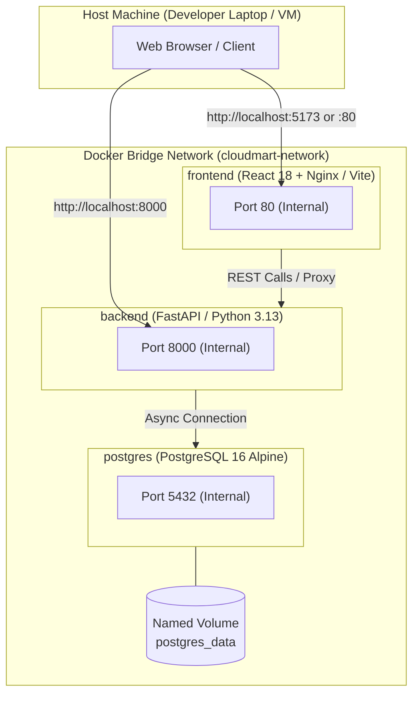

# CloudMart Docker & Containerization Runbook

## 1. Prerequisites

Before running CloudMart via Docker, ensure your development workstation meets the following prerequisites:
- **Docker Desktop**: Version 4.x or higher with Docker Compose v2/v5 engine installed.
- **Operating System Settings**:
  - **Windows**: Docker Desktop configured to use the **WSL 2 backend** (recommended) or Hyper-V.
  - **macOS**: Docker Desktop with VirtioFS enabled for optimal I/O throughput.
  - **Linux**: Docker CE 24.x+ and `docker-compose-plugin`.
- **System Resources**: Minimum 4 GB RAM allocated to Docker daemon (8 GB recommended).

---

## 2. Docker Architecture & Services

CloudMart runs as a three-tier containerized stack managed via `docker-compose.yml`:



### Service Breakdown

| Service Name | Base Image | Published Ports | Description |
| :--- | :--- | :--- | :--- |
| **`postgres`** | `postgres:16-alpine` | `5432:5432` | Relational database holding user accounts, catalog items, stock counts, and orders. Uses a persistent named volume. |
| **`backend`** | Custom Python 3.13 Slim | `8000:8000` | FastAPI ASGI web server running with Uvicorn. Implements all business domains and Alembic auto-migration on boot. |
| **`frontend`** | Custom Multi-Stage Node / Nginx | `5173:80` (or `80:80`) | Single Page Application compiled with Vite and served via high-performance Nginx web server. |

---

## 3. Quick Start

### 1. Configure Environment
Ensure `.env` exists in the project root:
```bash
cp .env.example .env
```

### 2. Launch Services
```bash
# Build images and start containers in the background
docker compose up --build -d
```

### 3. Verify Container Status
```bash
docker compose ps
```
*Expected Output:*
```text
NAME                  IMAGE                  COMMAND                  SERVICE      STATUS              PORTS
cloudmart-backend     cloudmart-backend      "uvicorn app.main:ap…"   backend      running (healthy)   0.0.0.0:8000->8000/tcp
cloudmart-frontend    cloudmart-frontend     "/docker-entrypoint.…"   frontend     running             0.0.0.0:5173->80/tcp
cloudmart-postgres    postgres:16-alpine     "docker-entrypoint.s…"   postgres     running (healthy)   0.0.0.0:5432->5432/tcp
```

### 4. Test API Health
```bash
curl http://localhost:8000/health
```

---

## 4. Multi-Stage Docker Build Explanation

CloudMart utilizes multi-stage Docker builds to minimize final image footprint, eliminate build-time tools from production runtimes, and maximize security posture.

### Backend Multi-Stage Build (`Dockerfile.backend`)
```dockerfile
# ==========================================
# Stage 1: Build Dependencies
# ==========================================
FROM python:3.13-slim AS builder

WORKDIR /build

RUN apt-get update && apt-get install -y --no-install-recommends \
    build-essential \
    libpq-dev \
    && rm -rf /var/lib/apt/lists/*

COPY requirements.txt .
RUN pip install --no-cache-dir --user -r requirements.txt

# ==========================================
# Stage 2: Final Lean Runtime
# ==========================================
FROM python:3.13-slim AS runner

WORKDIR /app

# Install runtime PostgreSQL client library only
RUN apt-get update && apt-get install -y --no-install-recommends \
    libpq5 \
    curl \
    && rm -rf /var/lib/apt/lists/*

# Copy installed Python packages from builder stage
COPY --from=builder /root/.local /root/.local
ENV PATH=/root/.local/bin:$PATH

# Non-root user creation for security
RUN groupadd -r cloudmart && useradd -r -g cloudmart cloudmart

COPY --chown=cloudmart:cloudmart . /app

USER cloudmart

EXPOSE 8000

CMD ["uvicorn", "app.main:app", "--host", "0.0.0.0", "--port", "8000"]
```

#### Advantages:
- Compilers (`gcc`, `build-essential`) are dropped from the final image, reducing size from ~850MB to ~145MB.
- Application executes as an unprivileged user (`cloudmart`), mitigating container breakout risks.

---

### Frontend Multi-Stage Build (`Dockerfile.frontend`)
```dockerfile
# ==========================================
# Stage 1: Vite Compile & Bundle
# ==========================================
FROM node:20-alpine AS builder

WORKDIR /app

COPY package*.json ./
RUN npm ci

COPY . .
RUN npm run build

# ==========================================
# Stage 2: Production Nginx Server
# ==========================================
FROM nginx:1.25-alpine AS runner

COPY nginx.conf /etc/nginx/conf.d/default.conf
COPY --from=builder /app/dist /usr/share/nginx/html

EXPOSE 80

CMD ["nginx", "-g", "daemon off;"]
```

#### Advantages:
- Node.js runtime and `node_modules` (often > 500MB) are discarded.
- Static assets are served directly by Alpine Nginx, yielding an image under 25MB with sub-millisecond response times.

---

## 5. Volume Management & Database Persistence

### Named Volume: `postgres_data`
Database files are stored in a Docker named volume (`postgres_data`) mapped to `/var/lib/postgresql/data` inside the PostgreSQL container.
- Container restarts or container rebuilds will **not** erase database data.
- The volume persists across standard `docker compose down` operations.

### Inspecting Database Volume
```bash
docker volume ls
docker volume inspect cloudmart_postgres_data
```

---

## 6. How to Reset Database Intentionally

During development, you may want to purge all existing tables, seeds, and test transactions to start with a clean slate:

### Method 1: Down with Volumes Flag (Recommended)
```bash
# 1. Stop containers and destroy named volumes
docker compose down -v

# 2. Relaunch services (database will initialize fresh and migrations will apply)
docker compose up -d

# 3. Seed initial catalog data
docker compose exec backend python -m app.seeds.initial_catalog
```

### Method 2: Reset Via Docker Volume Command
```bash
docker compose down
docker volume rm cloudmart_postgres_data
docker compose up -d
```

---

## 7. Common Docker Commands Reference

| Operation | Command |
| :--- | :--- |
| **Start Services** | `docker compose up -d` |
| **Stop Services** | `docker compose down` |
| **View Live Logs** | `docker compose logs -f` |
| **View Backend Logs Only** | `docker compose logs -f backend` |
| **Rebuild Single Service** | `docker compose build backend` |
| **Execute Shell in Backend** | `docker compose exec backend bash` (or `sh`) |
| **Access PostgreSQL CLI** | `docker compose exec postgres psql -U cloudmart_user -d cloudmart` |
| **Check Resource Usage** | `docker stats` |

---

## 8. Troubleshooting Guide

### 8.1 Port Conflict (`bind: address already in use`)
- **Symptom**: `Error response from daemon: Ports are not available: listen tcp 0.0.0.0:5432: bind: address already in use`
- **Cause**: A local instance of PostgreSQL (or previous container) is occupying port 5432 or 8000.
- **Resolution (Windows PowerShell)**:
  ```powershell
  # Find PID using port 5432
  netstat -ano | findstr :5432
  # Terminate process if needed
  Stop-Process -Id <PID> -Force
  ```
- **Resolution (Docker Compose Config)**:
  Change host port binding in `docker-compose.yml`:
  ```yaml
  ports:
    - "5433:5432" # Maps host 5433 to container 5432
  ```

### 8.2 Permission Denied on Mounted Volumes
- **Symptom**: `OperationalError: permission denied for relation users` or file creation errors.
- **Resolution**: Ensure the container user matches host UID/GID or check directory ownership:
  ```bash
  docker compose exec backend chown -R cloudmart:cloudmart /app
  ```

### 8.3 Slow Build Times
- **Symptom**: Docker rebuilds all dependencies every time a single file changes.
- **Resolution**: Verify `.dockerignore` excludes `node_modules`, `venv`, `.git`, and `__pycache__`:
  ```text
  # .dockerignore
  **/node_modules
  **/__pycache__
  **/*.pyc
  venv/
  .git/
  dist/
  ```
