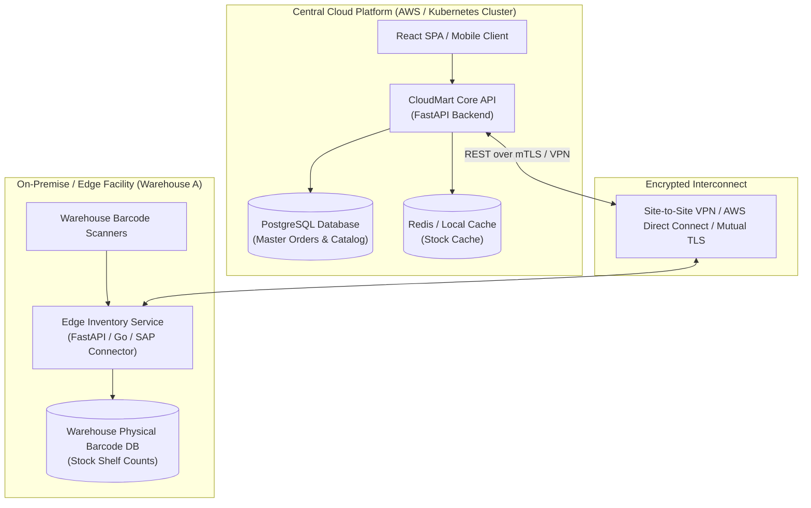
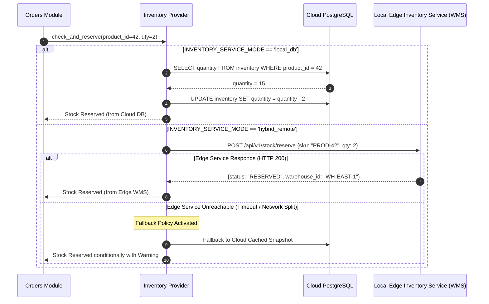

# CloudMart Hybrid-Cloud Architecture & Edge Inventory Integration

## 1. Hybrid Cloud Concept in CloudMart

In modern retail and enterprise commerce, inventory often does not live solely inside a centralized public cloud database. Physical warehouses, brick-and-mortar retail stores, and third-party fulfillment centers (3PL) maintain localized Warehouse Management Systems (WMS) or ERPs (Enterprise Resource Planning systems like SAP or NetSuite) on-premises.

In CloudMart, **hybrid cloud** refers to the strategic distribution of computing workloads and data storage between:
1. **The Cloud Tier (Public Cloud / Central Monolith)**: Hosting user profiles, shopping carts, product catalog definitions, payment gateways, and order state.
2. **The Edge / On-Premise Tier (Local Inventory Service)**: Authoritative for actual physical shelf quantities, warehouse bin allocations, and regional distribution center stock counts.



---

## 2. Local Inventory Service Concept

The local inventory service functions as an edge microservice deployed directly within the distribution center network:

- **Source of Truth for Stock**: While the cloud catalog maintains marketing copy, prices, and high-res imagery, the localized edge service owns exact stock availability.
- **Offline / Low-Latency Warehouse Operations**: Warehouse floor workers scan barcodes and restock shelves locally without roundtripping every barcode scan over public internet connections.
- **Stock Reservation Delegation**: When a customer initiates checkout in the cloud, the CloudMart backend sends a reservation request to the local inventory service to verify physical availability before finalizing payment.

---

## 3. Querying Local vs. Cloud Inventory: Architectural Flow

CloudMart's `inventory` module implements a **Pluggable Inventory Provider Pattern**. Depending on configuration, the backend can operate in **internal database mode** (pure monolith) or **hybrid remote mode** (querying the local inventory microservice):



---

## 4. Configuration & Fallback Mechanisms

CloudMart configures the inventory mode via environment variables:

```ini
# --- Inventory Service Mode Configuration ---
# Values: 'local_db' (monolith internal database) | 'hybrid_remote' (remote edge warehouse API)
INVENTORY_SERVICE_MODE=hybrid_remote

# Base URL of the edge warehouse inventory service
EDGE_INVENTORY_URL=http://localhost:8001/api/v1/stock
EDGE_INVENTORY_API_KEY=edge-secret-warehouse-token-xyz789

# Connection timeout in seconds before activating fallback
EDGE_INVENTORY_TIMEOUT_SECONDS=2.0

# Resilience Fallback Strategy: 'fail_closed' (block purchase) | 'fallback_to_cache' (use local replica)
INVENTORY_FALLBACK_STRATEGY=fallback_to_cache
```

### Python Implementation of Resilient Client (`app/modules/inventory/provider.py`)
```python
import httpx
import logging
from app.core.config import settings

logger = logging.getLogger(__name__)

class HybridInventoryProvider:
    def __init__(self, http_client: httpx.AsyncClient):
        self.client = http_client
        self.base_url = settings.EDGE_INVENTORY_URL
        self.mode = settings.INVENTORY_SERVICE_MODE

    async def reserve_stock(self, product_sku: str, quantity: int, db_session) -> bool:
        if self.mode == "local_db":
            # Direct internal SQLAlchemy reservation
            return await self._reserve_internal(product_sku, quantity, db_session)

        # Hybrid Remote Call with Circuit Protection
        try:
            response = await self.client.post(
                f"{self.base_url}/reserve",
                json={"sku": product_sku, "quantity": quantity},
                headers={"X-API-Key": settings.EDGE_INVENTORY_API_KEY},
                timeout=settings.EDGE_INVENTORY_TIMEOUT_SECONDS
            )
            if response.status_code == 200:
                return True
            elif response.status_code == 409:
                return False  # Physical stock unavailable
        except (httpx.RequestError, httpx.TimeoutException) as exc:
            logger.error(f"Edge inventory service unreachable: {exc}. Activating fallback.")
            if settings.INVENTORY_FALLBACK_STRATEGY == "fallback_to_cache":
                return await self._reserve_internal(product_sku, quantity, db_session)
            raise RuntimeError("Warehouse inventory offline; orders temporarily restricted.")

        return False
```

---

## 5. Limitations of the Local Development Demo

In the local development environment:
- The "Edge Inventory Service" is simulated using either an optional secondary FastAPI instance running on port 8001 or stubbed endpoints.
- Network latency is zero (loopback), which does not simulate real-world wide-area network (WAN) jitter, packet loss, or transient internet outages.
- Cryptographic TLS mutual authentication (mTLS) is disabled locally for convenience.

---

## 6. Extending to an Enterprise Production Hybrid Architecture

To transition this architecture to enterprise-scale production:

### 1. Dedicated Encrypted Network Interconnect
- **AWS Direct Connect**: High-bandwidth dedicated physical fiber connection between on-premise data centers and AWS VPCs, eliminating public internet routing.
- **AWS Site-to-Site VPN**: IPsec VPN tunnels with dual tunnels for automatic failover.

### 2. Asynchronous Event Streaming (Kafka / AWS SQS / SNS)
- Direct HTTP requests between cloud and edge introduce tight coupling and latency bottlenecks.
- Transitioning to **Apache Kafka** or **AWS SQS** enables event-driven inventory reconciliation:
  - When pallets arrive at the warehouse, the edge WMS emits an `InventoryRestockedEvent`.
  - Cloud consumers ingest the stream and update cloud read replicas asynchronously.

### 3. Circuit Breakers & Resiliency Patterns
- Integrate libraries such as **Netflix Hystrix** or Python's **pybreaker**.
- If 5 consecutive calls to the edge warehouse fail, the circuit trips OPEN, immediately routing requests to local cached estimates without wasting customer request threads waiting for timeouts.

### 4. Conflict Resolution & Two-Phase Locking
- Implement distributed leasing or optimistic concurrency tokens to prevent two simultaneous checkouts across physical retail POS (Point of Sale) and cloud web shoppers from reserving the exact same physical unit.
