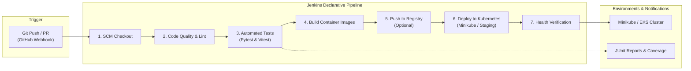

# CloudMart Jenkins CI/CD Pipeline Automation

## 1. Overview & CI/CD Pipeline Architecture

CloudMart features an end-to-end automated Continuous Integration and Continuous Deployment (CI/CD) pipeline implemented with a **declarative Jenkinsfile**. The pipeline automates code checkout, static analysis, unit/integration testing, multi-stage Docker container building, vulnerability scanning, and automated deployment to a local or staging Kubernetes cluster.



---

## 2. Setting Up Jenkins

You can run Jenkins either via Docker or installed directly on the host system.

### Option A: Running Jenkins via Docker (Recommended for Local Dev)
Use the official `jenkins/jenkins:lts-jdk17` image with Docker CLI passthrough to allow Jenkins to build sibling containers:

```bash
docker run -d \
  --name jenkins-cloudmart \
  -p 8080:8080 \
  -p 50000:50000 \
  -v jenkins_home:/var/jenkins_home \
  -v /var/run/docker.sock:/var/run/docker.sock \
  -v $(which docker):/usr/bin/docker \
  jenkins/jenkins:lts-jdk17
```

*Note for Windows users:* When mounting the Docker socket on Windows, configure Docker Desktop > Settings > Advanced > Enable "Expose daemon on tcp://localhost:2375 without TLS" or use WSL 2 paths.

Retrieve the initial admin password:
```bash
docker exec jenkins-cloudmart cat /var/jenkins_home/secrets/initialAdminPassword
```
Open your browser at `http://localhost:8080` and complete the initial setup wizard.

---

## 3. Required Jenkins Plugins

Navigate to **Manage Jenkins** &rarr; **Plugins** &rarr; **Available Plugins** and install:

| Plugin Name | Purpose | Mandatory? |
| :--- | :--- | :--- |
| **Pipeline** | Core declarative pipeline execution engine | Yes |
| **Docker Pipeline** | Native Docker building, tagging, and running within steps | Yes |
| **Kubernetes CLI (`kubeconfig`)** | Provides `withKubeConfig` wrapper to execute `kubectl` | Yes |
| **Git / GitHub Plugin** | SCM polling, commit status notifications, and webhooks | Yes |
| **Blue Ocean** | Modern visualization interface for multi-stage pipelines | Optional |
| **Warnings Next Generation** | Visualizes code linting and static analysis results | Optional |

---

## 4. Credentials Configuration

Navigate to **Manage Jenkins** &rarr; **Credentials** &rarr; **System** &rarr; **Global credentials** to add required secrets:

1. **`docker-registry-credentials`** *(Optional)*:
   - **Kind**: Username with password
   - **ID**: `docker-registry-credentials`
   - **Description**: Credentials for Docker Hub, Amazon ECR, or GitHub Container Registry (GHCR).

2. **`kubeconfig-staging`** *(Optional / Staging Deployment)*:
   - **Kind**: Secret file
   - **ID**: `kubeconfig-staging`
   - **Description**: Upload your `~/.kube/config` file (or Minikube kubeconfig) to allow Jenkins to authenticate with the target Kubernetes cluster.

---

## 5. Declarative Pipeline Definition (`Jenkinsfile`)

Place this `Jenkinsfile` at the root of the CloudMart repository:

```groovy
pipeline {
    agent any

    environment {
        REGISTRY_URL   = credentials('DOCKER_REGISTRY_URL') // Optional: e.g. docker.io/myorg
        IMAGE_BACKEND  = "cloudmart-backend"
        IMAGE_FRONTEND = "cloudmart-frontend"
        BUILD_TAG      = "${env.BUILD_NUMBER}"
        KUBECONFIG_ID  = "kubeconfig-staging"
    }

    options {
        timeout(time: 20, unit: 'MINUTES')
        buildDiscarder(logRotator(numToKeepStr: '10'))
        disableConcurrentBuilds()
    }

    stages {
        stage('Checkout Source') {
            steps {
                echo 'Checking out source code from Git repository...'
                checkout scm
            }
        }

        stage('Static Code Analysis & Linting') {
            steps {
                echo 'Running Flake8 on backend and ESLint on frontend...'
                dir('backend') {
                    sh '''
                        python3 -m venv venv
                        . venv/bin/activate
                        pip install flake8
                        flake8 app/ --max-line-length=100 --exclude=migrations
                    '''
                }
                dir('frontend') {
                    sh '''
                        npm ci
                        npm run lint --if-present
                    '''
                }
            }
        }

        stage('Automated Unit & Integration Tests') {
            steps {
                echo 'Executing Backend Pytest suite against in-memory SQLite...'
                dir('backend') {
                    sh '''
                        . venv/bin/activate
                        pip install -r requirements.txt pytest pytest-cov pytest-asyncio httpx
                        pytest tests/ -v --junitxml=junit-backend.xml --cov=app --cov-report=xml:coverage.xml
                    '''
                }
                echo 'Executing Frontend Vitest suite...'
                dir('frontend') {
                    sh '''
                        npm run test -- --run
                    '''
                }
            }
            post {
                always {
                    junit allowEmptyResults: true, testResults: 'backend/junit-backend.xml'
                }
            }
        }

        stage('Build Docker Images') {
            steps {
                echo 'Building multi-stage production Docker images...'
                sh """
                    docker build -t ${IMAGE_BACKEND}:${BUILD_TAG} -t ${IMAGE_BACKEND}:latest -f Dockerfile.backend backend/
                    docker build -t ${IMAGE_FRONTEND}:${BUILD_TAG} -t ${IMAGE_FRONTEND}:latest -f Dockerfile.frontend frontend/
                """
            }
        }

        stage('Push Images to Registry') {
            when {
                expression { env.REGISTRY_URL != null && env.REGISTRY_URL != "" }
            }
            steps {
                echo "Publishing container images to ${env.REGISTRY_URL}..."
                // Tag and push to remote registry
                sh """
                    docker tag ${IMAGE_BACKEND}:${BUILD_TAG} ${REGISTRY_URL}/${IMAGE_BACKEND}:${BUILD_TAG}
                    docker push ${REGISTRY_URL}/${IMAGE_BACKEND}:${BUILD_TAG}
                """
            }
        }

        stage('Deploy to Kubernetes') {
            steps {
                echo 'Deploying application manifests to Kubernetes...'
                // If using Minikube on host:
                sh '''
                    kubectl apply -f k8s/namespace.yaml
                    kubectl apply -f k8s/ -n cloudmart
                    kubectl rollout status deployment/backend-deployment -n cloudmart --timeout=120s
                    kubectl rollout status deployment/frontend-deployment -n cloudmart --timeout=120s
                '''
            }
        }

        stage('Sanity Health Check') {
            steps {
                echo 'Validating deployment health check...'
                sh '''
                    kubectl wait --for=condition=ready pod -l app=backend -n cloudmart --timeout=60s
                    echo "CloudMart successfully deployed and healthy."
                '''
            }
        }
    }

    post {
        success {
            echo "CI/CD Pipeline succeeded for build ${env.BUILD_NUMBER}!"
        }
        failure {
            echo "CI/CD Pipeline failed! Review stage logs above."
        }
    }
}
```

---

## 6. How to Trigger Builds

### Method 1: Webhook Trigger (Automatic on Git Push)
1. In your GitHub / GitLab repository settings, navigate to **Webhooks** &rarr; **Add Webhook**.
2. Set Payload URL: `http://<your-jenkins-host>:8080/github-webhook/`.
3. Set Content type: `application/json`.
4. Trigger on **Pushes** and **Pull Requests**.
5. In Jenkins Pipeline configuration, check **GitHub hook trigger for GITScm polling**.

### Method 2: Manual Trigger ("Build Now")
1. Open the CloudMart project item in the Jenkins dashboard.
2. Click **Build Now** on the left menu.
3. Monitor progress in the **Build History** or via the **Blue Ocean** interface.

---

## 7. Troubleshooting Jenkins Pipelines

### 1. `docker: command not found` or `permission denied /var/run/docker.sock`
- **Cause**: Jenkins container lacks the Docker binary or file permissions to access the Docker Unix socket.
- **Fix**: Grant the Jenkins user permission to access the socket:
  ```bash
  docker exec -u 0 -it jenkins-cloudmart chmod 666 /var/run/docker.sock
  ```

### 2. `error: unable to connect to Kubernetes cluster`
- **Cause**: `kubectl` inside Jenkins cannot reach the Minikube API server on `127.0.0.1` because `localhost` refers to the container itself.
- **Fix**: Use the host internal IP or Minikube IP (`minikube ip`) inside the kubeconfig file instead of `127.0.0.1`.

### 3. Pytest Fails Due to Missing Python Dependencies
- **Cause**: Reusing a cached virtual environment or missing C-compilers for extensions.
- **Fix**: Ensure the pipeline script executes `pip install --upgrade pip` and installs all wheels before running test commands.
