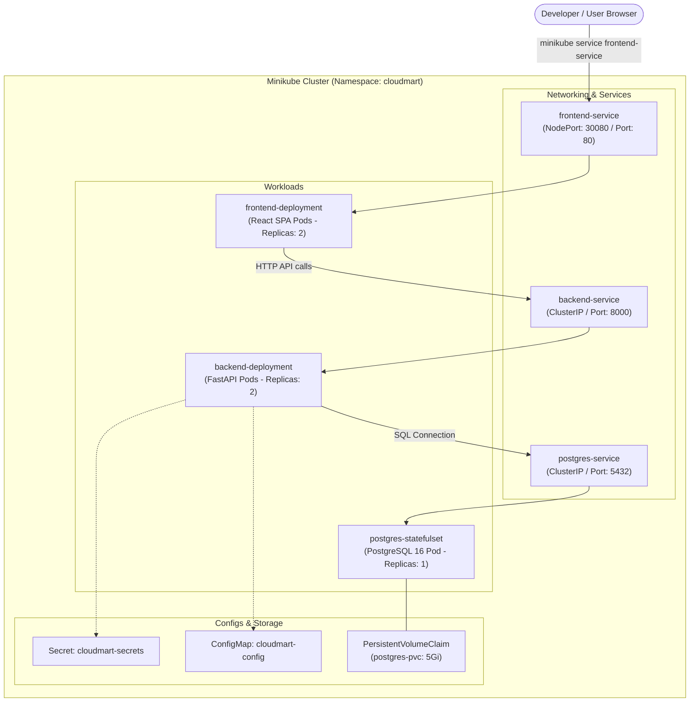

# CloudMart Kubernetes (Minikube) Deployment Runbook

## 1. Overview & Architecture

This guide covers deploying the CloudMart platform onto a local **Kubernetes** cluster using **Minikube**. The Kubernetes topology decouples application services into independent pods, manages secrets securely, mounts persistent storage volumes, and handles ingress and service routing.



---

## 2. Prerequisites

Verify tool installations before proceeding:
- **Minikube**: Version v1.39+ (`minikube version`)
- **Kubectl**: Version v1.36+ (`kubectl version --client`)
- **Docker Desktop**: Version 4.x+ with Docker daemon running

---

## 3. Starting the Local Cluster

Launch Minikube using the Docker driver:

```bash
minikube start --driver=docker --cpus=4 --memory=6144 --disk-size=20g
```

Verify cluster readiness:
```bash
kubectl cluster-info
kubectl get nodes
```

---

## 4. Building & Loading Docker Images into Minikube

Kubernetes cannot pull images from your local host machine without either:
1. Reusing the Minikube Docker daemon, OR
2. Using `minikube image load` to transfer images directly.

### Option A: Direct Minikube Image Load (Universal & Reliable)
Build the images locally on your host, then inject them into Minikube:

```powershell
# 1. Build local container images
docker build -t cloudmart-backend:latest -f Dockerfile.backend backend/
docker build -t cloudmart-frontend:latest -f Dockerfile.frontend frontend/

# 2. Transfer images directly into Minikube cluster
minikube image load cloudmart-backend:latest
minikube image load cloudmart-frontend:latest
```

### Option B: Point Docker CLI to Minikube Daemon (PowerShell vs Bash)

#### Windows (PowerShell):
```powershell
# Point current PowerShell session to Minikube's Docker daemon
& minikube -p minikube docker-env --shell powershell | Invoke-Expression

# Build images directly inside Minikube's daemon
docker build -t cloudmart-backend:latest -f Dockerfile.backend backend/
docker build -t cloudmart-frontend:latest -f Dockerfile.frontend frontend/
```

#### Linux / macOS (Bash / Zsh):
```bash
# Point current shell session to Minikube's Docker daemon
eval $(minikube docker-env)

# Build directly
docker build -t cloudmart-backend:latest -f Dockerfile.backend backend/
docker build -t cloudmart-frontend:latest -f Dockerfile.frontend frontend/
```

To verify loaded images:
```bash
minikube image ls --format table | grep cloudmart
```

---

## 5. Kubernetes Manifests Structure

All Kubernetes resource definitions reside in the `k8s/` directory:

```text
k8s/
├── namespace.yaml               # Defines the 'cloudmart' namespace
├── secrets.yaml                 # Database credentials and JWT secrets
├── configmap.yaml               # Environment variables (URLs, logging levels)
├── postgres-pvc.yaml            # PersistentVolumeClaim for database files
├── postgres-statefulset.yaml    # PostgreSQL StatefulSet & headless Service
├── backend-deployment.yaml      # FastAPI deployment with liveness/readiness probes
└── frontend-deployment.yaml     # React Nginx deployment & NodePort Service
```

---

## 6. Deploying CloudMart Step-by-Step

### Step 1: Create Namespace
```bash
kubectl apply -f k8s/namespace.yaml
```
*(Or imperatively: `kubectl create namespace cloudmart`)*

### Step 2: Create Secrets
To create secrets securely from your local `.env` file:
```bash
kubectl create secret generic cloudmart-secrets \
  --from-env-file=.env \
  -n cloudmart
```

Or apply the manifest file directly:
```bash
kubectl apply -f k8s/secrets.yaml -n cloudmart
```

### Step 3: Deploy PostgreSQL StatefulSet & Storage
```bash
kubectl apply -f k8s/postgres-pvc.yaml -n cloudmart
kubectl apply -f k8s/postgres-statefulset.yaml -n cloudmart

# Wait for PostgreSQL to be ready
kubectl wait --for=condition=ready pod -l app=postgres -n cloudmart --timeout=90s
```

### Step 4: Deploy Backend Application
```bash
kubectl apply -f k8s/backend-deployment.yaml -n cloudmart

# Monitor rollout status
kubectl rollout status deployment/backend-deployment -n cloudmart
```

### Step 5: Deploy Frontend Application
```bash
kubectl apply -f k8s/frontend-deployment.yaml -n cloudmart

# Monitor rollout status
kubectl rollout status deployment/frontend-deployment -n cloudmart
```

### Deploy All Manifests in One Command:
```bash
kubectl apply -f k8s/ -n cloudmart
```

---

## 7. Verification & Status Inspection

Check all workloads running in the `cloudmart` namespace:
```bash
kubectl get all -n cloudmart
```

*Expected Output:*
```text
NAME                                       READY   STATUS    RESTARTS   AGE
pod/backend-deployment-688c5c7db6-j9b4d    1/1     Running   0          2m
pod/backend-deployment-688c5c7db6-z8wlk    1/1     Running   0          2m
pod/frontend-deployment-7cb7f7d45f-4xmn8   1/1     Running   0          1m
pod/frontend-deployment-7cb7f7d45f-m3jkl   1/1     Running   0          1m
pod/postgres-0                             1/1     Running   0          3m

NAME                       TYPE        CLUSTER-IP       EXTERNAL-IP   PORT(S)        AGE
service/backend-service    ClusterIP   10.103.45.12     <none>        8000/TCP       2m
service/frontend-service   NodePort    10.108.120.89    <none>        80:30080/TCP   1m
service/postgres-service   ClusterIP   10.96.220.15     <none>        5432/TCP       3m
```

---

## 8. Accessing the Application

### Method 1: Minikube Service URL (Recommended)
Minikube will create a browser bridge and open the frontend service URL automatically:
```bash
minikube service frontend-service -n cloudmart
```

To get the URL without launching a browser:
```bash
minikube service frontend-service -n cloudmart --url
```

### Method 2: Port-Forwarding (Direct Developer Access)
You can forward local host ports directly into the Kubernetes cluster pods:

```powershell
# Terminal 1: Forward Frontend to localhost:3000
kubectl port-forward service/frontend-service 3000:80 -n cloudmart

# Terminal 2: Forward Backend API to localhost:8000
kubectl port-forward service/backend-service 8000:8000 -n cloudmart

# Terminal 3: Forward Database to localhost:5432
kubectl port-forward service/postgres-service 5432:5432 -n cloudmart
```

Now browse to `http://localhost:3000` (Frontend) and `http://localhost:8000/docs` (Swagger UI).

---

## 9. Pod Logs & Diagnostic Commands

```bash
# View backend application logs
kubectl logs -l app=backend -n cloudmart -f

# View PostgreSQL container logs
kubectl logs pod/postgres-0 -n cloudmart

# Describe a crashing pod for events and exit codes
kubectl describe pod <pod-name> -n cloudmart

# Execute interactive shell inside backend pod
kubectl exec -it deployment/backend-deployment -n cloudmart -- /bin/bash
```

---

## 10. Cluster Teardown & Cleanup

### Remove CloudMart Workloads:
```bash
# Delete all resources in the cloudmart namespace
kubectl delete -f k8s/ -n cloudmart

# Or delete the entire namespace
kubectl delete namespace cloudmart
```

### Stop or Destroy Minikube Cluster:
```bash
# Stop the Minikube virtual machine / container (saves state)
minikube stop

# Completely delete the cluster and release disk space
minikube delete
```
