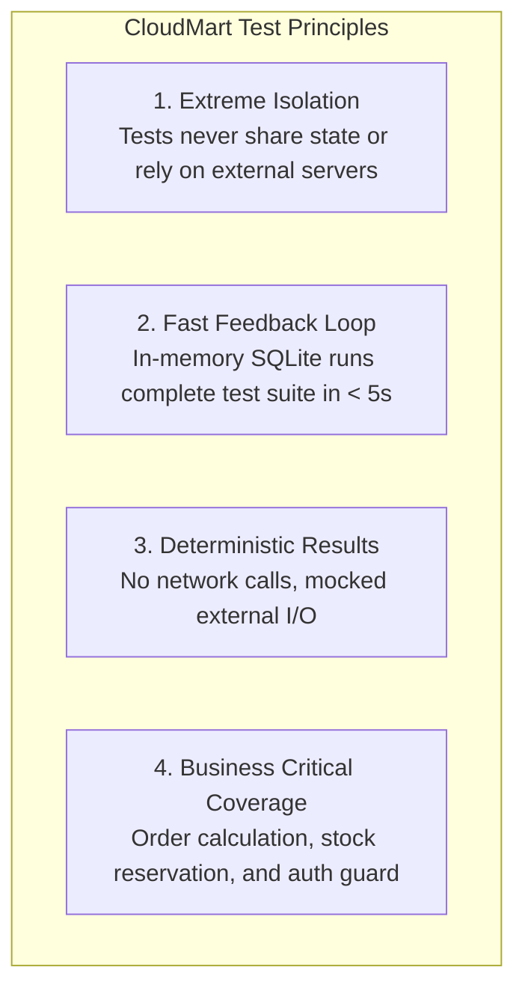

# CloudMart Testing Strategy & Guide

## 1. Test Philosophy & Principles

CloudMart is designed with high testability at its core. Reliable tests must be fast, deterministic, repeatable, and completely isolated from external system dependencies.



### Key Pillars:
1. **No External Database for Unit & Integration Tests**: Unit and module-level integration tests run against an **in-memory SQLite database** using SQLAlchemy's async SQLite driver (`aiosqlite`) or synchronous SQLite engine for testing. Tests never connect to a live PostgreSQL instance.
2. **Schema Mirroring**: Tables are dynamically generated at the beginning of each test session from SQLAlchemy metadata (`Base.metadata.create_all`), guaranteeing that tests validate the exact models running in production.
3. **Transactional Isolation**: Each test executes inside its own database transaction that is rolled back after test completion (`db_session` fixture), ensuring test independence.
4. **Mocked Side Effects**: External network dependencies (AWS S3, email dispatch, edge warehouse HTTP calls) are replaced with deterministic test doubles and pytest mocks.

---

## 2. Backend Test Suites & Categories

Tests are organized cleanly within the `backend/tests/` directory:

```text
backend/tests/
├── conftest.py                # Pytest fixtures (test client, db session, token generators)
├── unit/
│   ├── test_security.py       # Password hashing, JWT creation & token decoding
│   ├── test_pricing.py        # Order price calculations, taxes, discount logic
│   └── test_event_bus.py      # Async in-process event publish/subscribe
└── integration/
    ├── test_auth_api.py       # /auth/register, /auth/login, /auth/me flows
    ├── test_products_api.py   # Product CRUD, pagination, filtering, admin permissions
    ├── test_orders_flow.py    # Order placement, atomic inventory reservation, out-of-stock
    └── test_health_api.py     # System health check verification
```

### What Each Test Category Covers:

| Category | Target Domain | Key Test Scenarios |
| :--- | :--- | :--- |
| **Security & Auth Tests** | `app.modules.auth` | - Password hashing and bcrypt salt verification.<br/>- Token expiration and tampering handling.<br/>- Role validation (ensuring regular users cannot access admin endpoints). |
| **Catalog & Products** | `app.modules.products` | - CRUD operations with Pydantic validation.<br/>- Pagination limits (page sizing, out-of-bounds pages).<br/>- Unauthorized modification attempts rejected with 403 Forbidden. |
| **Inventory & Orders Flow** | `app.modules.orders` & `inventory` | - **Server-side price verification**: Manipulated client prices are ignored.<br/>- **Atomic stock decrement**: Stock is decremented accurately.<br/>- **Concurrency / Over-allocation**: 409 Conflict returned if stock is 0.<br/>- **Order cancellation**: Inventory is restocked on status change. |
| **Event Bus & Notifications** | `app.core.events` | - Asynchronous delivery of `OrderPlacedEvent`.<br/>- Ensuring notification failure does not cause HTTP request rollback. |

---

## 3. Pytest Fixture Architecture (`conftest.py`)

A representative setup demonstrating SQLite in-memory isolation and dependency overrides:

```python
import pytest
from httpx import AsyncClient, ASGITransport
from sqlalchemy.ext.asyncio import create_async_engine, AsyncSession
from sqlalchemy.orm import sessionmaker

from app.main import app
from app.core.database import Base, get_db
from app.core.security import create_access_token

# In-memory SQLite database URL for tests
TEST_DATABASE_URL = "sqlite+aiosqlite:///:memory:"

@pytest.fixture(scope="session")
def anyio_backend():
    return "asyncio"

@pytest.fixture(scope="session")
async def test_engine():
    engine = create_async_engine(TEST_DATABASE_URL, echo=False)
    async with engine.begin() as conn:
        await conn.run_sync(Base.metadata.create_all)
    yield engine
    await engine.dispose()

@pytest.fixture
async def db_session(test_engine):
    """Provides an isolated database session per test."""
    async_session = sessionmaker(
        test_engine, class_=AsyncSession, expire_on_commit=False
    )
    async with async_session() as session:
        yield session
        await session.rollback()

@pytest.fixture
async def client(db_session):
    """FastAPI AsyncClient overriding database dependency."""
    async def override_get_db():
        yield db_session

    app.dependency_overrides[get_db] = override_get_db
    transport = ASGITransport(app=app)
    async with AsyncClient(transport=transport, base_url="http://testserver") as ac:
        yield ac
    app.dependency_overrides.clear()

@pytest.fixture
def customer_auth_headers():
    token = create_access_token(data={"sub": "customer@example.com", "role": "customer", "user_id": 1})
    return {"Authorization": f"Bearer {token}"}

@pytest.fixture
def admin_auth_headers():
    token = create_access_token(data={"sub": "admin@cloudmart.com", "role": "admin", "user_id": 99})
    return {"Authorization": f"Bearer {token}"}
```

---

## 4. Running Backend Tests Locally

Ensure your virtual environment is active:

```bash
cd backend

# 1. Run all tests with standard verbose output
pytest -v

# 2. Run a specific test suite or file
pytest tests/integration/test_orders_flow.py -v

# 3. Filter tests by keyword expression
pytest -k "test_order_out_of_stock" -v

# 4. Generate coverage report
pytest --cov=app tests/ --cov-report=term-missing --cov-report=html

# 5. Fail the build if test coverage is below 80%
pytest --cov=app --cov-fail-under=80 tests/
```

---

## 5. Running Tests in Docker

You can execute tests inside an isolated Docker container without configuring local Python or dependencies:

```bash
# Build test runner container
docker build -t cloudmart-backend-test --target test -f Dockerfile.backend .

# Run pytest inside the container
docker run --rm cloudmart-backend-test pytest -v --cov=app

# Alternatively, run tests directly within the running backend compose container
docker compose exec backend pytest -v
```

---

## 6. Frontend Testing

CloudMart's frontend includes testing configurations using **Vitest** and **React Testing Library**:

- **Location**: `frontend/src/__tests__/`
- **Scope**:
  - Cart state transitions (adding items, incrementing quantity, calculating cart subtotal).
  - Component rendering for Product Cards and Order Badges.
  - API client error interceptor behavior on HTTP 401 Unauthorized.

### Running Frontend Tests:
```bash
cd frontend

# Run all test suites
npm test

# Run tests with interactive watch mode
npm run test:watch

# Run tests with code coverage
npm run test:coverage
```

---

## 7. CI Pipeline Test Integration

In automated CI environments (such as Jenkins or GitHub Actions), tests are executed before any deployment artifact is generated:

```groovy
stage('Unit & Integration Tests') {
    steps {
        dir('backend') {
            sh '''
                python -m venv venv
                . venv/bin/activate
                pip install -r requirements.txt pytest pytest-cov pytest-asyncio httpx
                pytest tests/ --cov=app --cov-report=xml:coverage.xml --junitxml=junit-report.xml
            '''
        }
    }
    post {
        always {
            junit 'backend/junit-report.xml'
        }
    }
}
```
